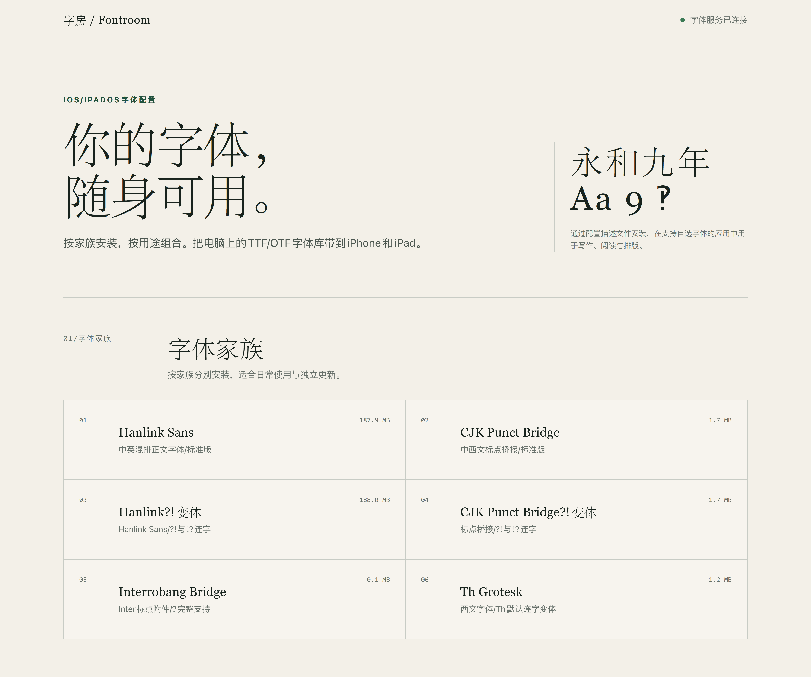

# 字房 / Fontroom

**把项目地址和字体文件交给 AI，轻松完成字体安装。**

AI 负责生成安装文件、搭建安装页面。打开安装地址，在手机上确认安装即可。

字房将电脑上的 TTF/OTF 字体整理成 iPhone 和 iPad 可安装的配置描述文件。整族安装、按用途组合，或从网页中自由勾选，让常用字体随身可用。



## 一座字体库，三种安装方式

| 方式   | 用法                       |
| ---- | ------------------------ |
| 字体家族 | 一次安装同一家族的多个字重及斜体，分别维护与更新 |
| 字体合集 | 将多个家族按用途整理，一次下载、集中安装     |
| 自选字体 | 在网页勾选需要的字体，现场生成安装文件      |

字体数据包含在描述文件中。设备安装完成后，可以在支持自定义字体的应用中继续使用；电脑只需在分发时运行服务。

## 快速开始

准备 Python 3.10 或更新版本，以及一个存放独立 TTF/OTF 文件的目录。在 PowerShell 中运行：

```powershell
git clone https://github.com/Speechlessmanbilibili/fontroom.git
cd fontroom
python -X utf8 -m pip install fonttools
$env:FONT_DIR = "D:\Fonts"
python -X utf8 server.py
```

将 `D:\Fonts` 换成自己的字体目录。终端会显示安装网页的局域网地址，网页中的“自选字体”可直接读取该目录。

## 使用家族预设

页面提供 Hanlink Sans、CJK Punct Bridge、对应的 ?! 变体、Interrobang Bridge 和 Th Grotesk 家族入口。准备好相邻字体工程的静态输出后，生成安装文件：

```powershell
python -X utf8 generate_profile.py
```

生成的文件保存在 `profiles/`，页面按家族展示。目录与生成命令见[使用说明](docs/usage.md)。

## 在 iPhone 或 iPad 上安装

1. 手机与电脑连接同一局域网，在 Safari 打开终端显示的地址。
2. 选择家族、合集，或展开“自选字体”生成安装文件，允许 Safari 下载描述文件。
3. 打开“设置/已下载描述文件”，按提示安装，再到“通用/字体”查看。

之后在应用的字体列表中选择字体即可。[Apple 安装说明](https://support.apple.com/zh-cn/102400)

## 字体格式

| 格式 | 使用方式 |
|---|---|
| 独立 `.ttf`、`.otf` | 直接扫描并封装到安装描述文件，扩展名识别忽略大小写 |
| 字体集合 `.ttc`、`.otc` | 先拆分为独立 TTF/OTF，再接入字体库 |
| 网页字体 `.woff`、`.woff2` | 用于网页嵌入；系统安装使用对应的 TTF/OTF |

TTF/OTF 是文件格式；静态与可变是另一项字体属性。

[Apple 字体描述文件格式](https://developer.apple.com/documentation/devicemanagement/font)

## 使用与维护

- [字体来源、命令行、接口与维护](docs/usage.md)
- [描述文件实现、安装实测与排障记录](docs/installation-notes.md)
- [开发约定](AGENTS.md)

运行测试：

```powershell
python -X utf8 -m unittest discover tests
```

## 许可证

服务器、生成器、网页与文档采用 [MIT License](LICENSE)。

字体遵循各自的授权协议，使用与分发时应保留对应的许可证和版权信息。
